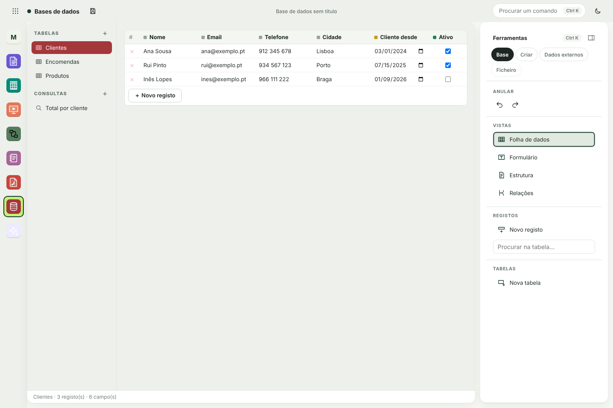
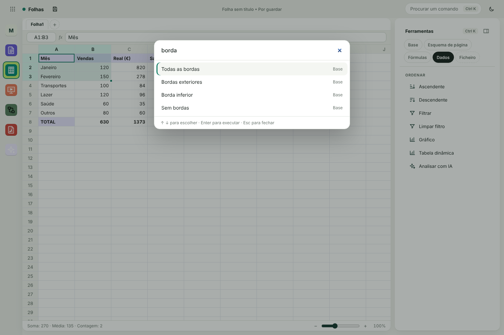
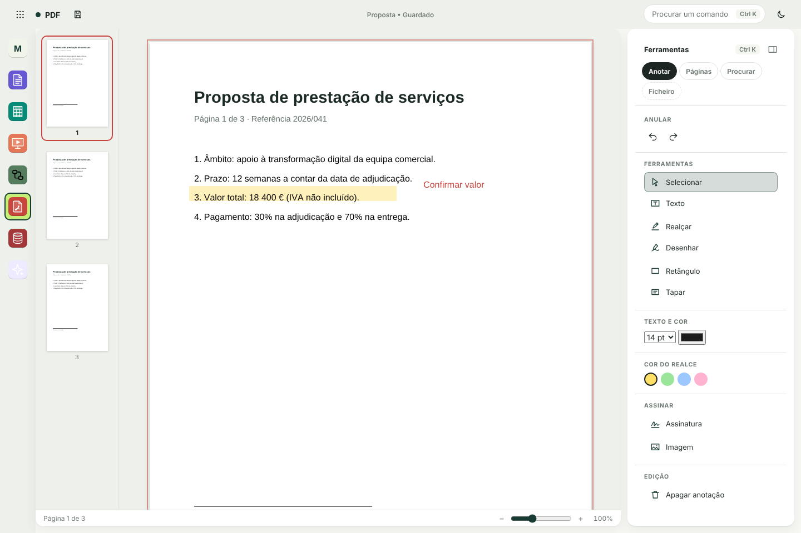
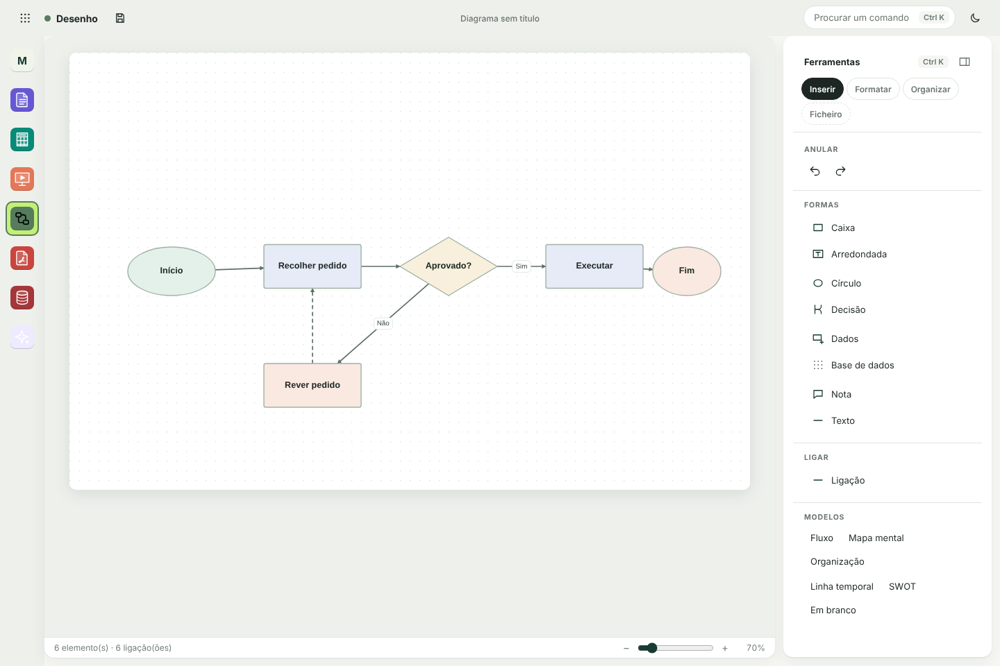

# MyOffice

**Suite de escritório para Windows: simples, privada e leve.**

Sete programas independentes — **Texto, Folhas, Diapositivos, Desenho, PDF, Bases de dados e Assistente** — instalados de uma só vez. Os documentos ficam no seu computador: não é precisa conta, nuvem nem ligação à Internet. Abre e grava ficheiros do Word, Excel e PowerPoint, importa bases de dados do Access e liga a servidores MySQL, PostgreSQL e SQL Server.

**[⬇ Descarregar MyOffice 1.12.0 para Windows (64 bits)](https://github.com/cadorio/myoffice/releases/download/v1.12.0/MyOffice-Setup-1.12.0.exe)**

Também disponível como [MSI para empresas](https://github.com/cadorio/myoffice/releases/download/v1.12.0/MyOffice-1.12.0-x64.msi) e [ZIP portátil](https://github.com/cadorio/myoffice/releases/download/v1.12.0/MyOffice-1.12.0-x64-portatil.zip) · [Somas SHA-256](https://github.com/cadorio/myoffice/releases/download/v1.12.0/SHA256SUMS.txt)

[Notas da versão](https://github.com/cadorio/myoffice/releases/tag/v1.12.0) · [Versões anteriores](https://github.com/cadorio/myoffice/releases) · [Reportar um problema](https://github.com/cadorio/myoffice/issues)



## Índice

- [Um visual próprio](#um-visual-próprio)
- [As aplicações](#as-aplicações)
- [Instalação](#instalação)
- [Ficheiros do Microsoft Office](#ficheiros-do-microsoft-office)
- [Assistente](#assistente)
- [Fórmulas](#fórmulas)
- [Privacidade e segurança](#privacidade-e-segurança)
- [O que ainda não faz](#o-que-ainda-não-faz)
- [Desenvolvimento](#desenvolvimento)

## Um visual próprio

O MyOffice não imita o Office. Em vez da faixa de separadores no topo, cada aplicação tem um **estúdio**:

- **O documento ao centro**, com espaço para trabalhar e sem barras a ocupar o ecrã.
- **Painel de ferramentas à direita**, organizado em secções (Tipo de letra, Bordas, Alinhar…). Esconde-se com **Ctrl+.** quando precisa de mais espaço.
- **Cada programa na sua janela**: abre no seu próprio ecrã de início, com documento em branco, modelos e ficheiros recentes desse tipo. O botão de grelha no canto abre outro programa.
- **Procura de comandos (Ctrl+K)**: escreva o que quer fazer, como "borda", "gráfico" ou "PDF", e carregue em Enter. Não precisa de saber onde está cada botão.



Tons calmos de verde e papel, com modo claro e escuro.

## As aplicações

| Aplicação | Para quê | Formatos |
| --- | --- | --- |
| **Texto** | Cartas, relatórios e atas, com estilos, tabelas, imagens, gráficos, comentários, controlo de alterações, notas de rodapé, índice e mala direta | `.modoc` · DOCX · PDF · HTML · TXT |
| **Folhas** | Contas, orçamentos e análise de dados, com fórmulas, gráficos de 8 tipos, formatação condicional e várias folhas por livro | `.mosheet` · XLSX · CSV · PDF |
| **Diapositivos** | Apresentações com temas, esquemas, imagens, formas, transições e notas do orador | `.moslides` · PPTX · PDF |
| **Desenho** | Fluxogramas, mapas mentais, organogramas e esquemas | `.modraw` · SVG · PNG · PDF |
| **PDF** | Ler, anotar, assinar, juntar e organizar ficheiros PDF | PDF · TXT |
| **Bases de dados** | Tabelas, formulários, consultas e relatórios, como o Access; ligação a MySQL, PostgreSQL e SQL Server | `.modb` (SQLite) · XLSX · CSV · importa Access |
| **Assistente** | Guias passo a passo, fórmulas, rascunhos de cartas e análise de textos e tabelas, sem Internet | — |

**Modelos prontos a usar** no início de cada programa: relatório e ata de reunião (Texto), orçamento mensal e gestor de tarefas (Folhas), apresentação de projeto e de aula (Diapositivos), fluxograma, mapa mental, organograma, linha temporal e SWOT (Desenho), clientes, inventário e encomendas (Bases de dados).

### Texto


- Estilos de título, tipos de letra, cores, listas, tabelas, ligações e imagens.
- Cabeçalhos e rodapés com número da página e total de páginas, também no PDF e no DOCX.
- Localizar e substituir, quebras de página e contagem de palavras com tempo de leitura.
- Revisão ortográfica em português, quando o Windows a disponibiliza.
- **Gráficos** (Inserir › Gráfico): escolha o tipo e escreva ou cole os dados.
- **Parágrafo**: espaçamento entre linhas (1,0 a 3,0), espaço antes e depois, avanço da primeira linha e **colunas** de texto (2 ou 3).
- **Letra**: expoente e índice (x², H₂O), MAIÚSCULAS / minúsculas / Primeira Letra Maiúscula e **pincel de formatação**.
- **Tabelas**: inserir e eliminar linhas e colunas, unir e separar células, linha de cabeçalho (repete-se em cada página no Word) e cor de fundo das células.
- **Imagens**: clique numa imagem para mudar o tamanho (25 % a 100 %), alinhar ou pôr o texto à volta.
- **Inserir** símbolos (©, €, →, ✓…) e a data de hoje.
- **Mala direta** (separador Correspondência): escolha uma lista do Excel ou CSV, insira os campos «Nome», «Cidade»… e crie uma carta por destinatário.
- **Rever**: comentários, controlo de alterações (aceitar ou rejeitar), notas de rodapé e índice automático.
- **Configurar página**: tamanho (A4, Carta, A5), orientação e margens.

### Folhas


- Até 100 000 linhas × 256 colunas por folha e até 100 folhas por livro, com separadores que se podem renomear.
- Mais de 30 funções, em português e em inglês (ver [Fórmulas](#fórmulas)).
- **Gráficos** de 8 tipos (colunas, colunas empilhadas, barras, linhas, área, circular, anel e dispersão), com várias séries, título, legenda, valores e paletas de cores. Selecione a tabela, abra **Dados › Gráfico** e o gráfico fica **sobre a folha**: arraste para mover, mude o tamanho pelo canto e faça duplo clique para editar. Acompanha as alterações aos dados e vai para o Excel como gráfico nativo.
- **Resumo dinâmico**: agrupa categorias e calcula soma, contagem e média com fórmulas que se atualizam com os dados. É uma alternativa às tabelas dinâmicas do Excel, não uma tabela dinâmica compatível.
- Bordas, unir e centrar células, fixar linhas e colunas, larguras de coluna (arrastar ou duplo clique para ajustar).
- **Preenchimento automático**: arraste o canto da célula para continuar números, meses, dias da semana e fórmulas.
- **Formatação condicional**: maior/menor que, entre, igual, contém texto e escala de cores.
- Estatística (mediana, moda, desvio padrão, variância), formatos de número e moeda, ordenação e filtros rápidos (os filtros não ficam guardados no ficheiro).

### Diapositivos


- 13 temas, cada um com quatro variantes de cor (Claro, Suave, Vivo, Escuro), e cinco esquemas de diapositivo.
- **Ideias de design**: propostas de composição com o conteúdo atual, que se aplicam com um clique e se podem anular.
- Transições (desvanecer, deslizar, revelar) e efeitos simples de entrada por elemento, também em PPTX.
- Notas do orador, modo de apresentação em ecrã inteiro e **vista do apresentador** (diapositivo seguinte, notas e cronómetro; tecla P).
- **Gráficos** (Inserir › Gráfico) e **tabelas**, organizador de diapositivos com arrastar e largar, e alinhar, distribuir e agrupar vários objetos (Shift+clique).
- Atalhos: Ctrl+D duplica um elemento, as setas movem-no e Shift+setas move-o em passos maiores.

### PDF



- Abrir e ler PDF, com miniaturas das páginas, zoom e procura de texto.
- **Anotar**: escrever texto em qualquer sítio (ótimo para preencher formulários), realçar, desenhar à mão, retângulos e **Tapar** (cobrir uma zona com branco).
- **Assinar**: desenhe a assinatura com o rato, a caneta ou o dedo, ou use uma imagem digitalizada, e coloque-a na página.
- **Páginas**: rodar, reordenar (arrastando as miniaturas), apagar, inserir páginas em branco, **juntar** outro PDF e **extrair** páginas para um PDF novo.
- Guardar grava as alterações no próprio PDF (Ctrl+S) e anular/refazer funciona com Ctrl+Z e Ctrl+Y. Também exporta o texto do PDF.
- Os ficheiros PDF abrem diretamente no MyOffice PDF a partir do Explorador do Windows.

### Bases de dados


Uma alternativa simples ao Access, num único ficheiro `.modb` (SQLite) no seu computador.

**O que o torna diferente:**

- **Pergunte em português** (Criar › Consulta): "clientes de Lisboa ativos", "total de encomendas por cliente", "os 5 produtos mais caros", "encomendas deste mês". O programa gera a consulta SQL, explica o que entendeu e mostra o resultado; o SQL fica visível e editável.
- **Formulários com os registos ligados**: a ficha de um cliente mostra logo as encomendas dele, que se editam e acrescentam ali mesmo. Em **Personalizar** escolhe a ordem dos campos e os que aparecem.
- **Relações**: diagrama automático das tabelas e das ligações entre elas.
- **Regras e integridade**: campos obrigatórios (assinalados a vermelho quando vazios), valores únicos, mínimo e máximo nos números, e não deixa eliminar um registo que outros usam (por exemplo, um cliente com encomendas).
- **Relatórios com grupos e totais**: agrupe por um campo (por exemplo, categoria) com subtotais e total geral.

- **Tabelas** com tipos de campo: texto, número, moeda, data, sim/não, lista de opções e **ligação a outra tabela** (por exemplo, a encomenda ligada ao cliente e ao produto).
- **Folha de dados** para editar como numa folha de cálculo, com procura e ordenação, e **Formulário** para ver e editar um registo de cada vez.
- **Estrutura**: acrescentar, mudar o nome, mudar o tipo (os valores são convertidos) e eliminar campos.
- **Consultas** sem escrever código (tabela, condição e ordenação) ou em **SQL**, guardadas na própria base. Instruções que alteram dados pedem confirmação e avisam quando não têm condição (`WHERE`).
- **Relatórios** prontos a imprimir ou exportar para PDF.
- **Importar** do Excel (cada folha vira uma tabela), de CSV e do **Access** (`.accdb`, `.mdb`: tabelas e dados; consultas, formulários e macros do Access não são convertidos). **Exportar** para Excel e CSV.
- Modelos: Clientes, Inventário e Encomendas. Anular e refazer com Ctrl+Z / Ctrl+Y.

**Ligação a servidores** (na aplicação instalada): em **Dados externos › Ligar a servidor**, ligue a **MySQL/MariaDB**, **PostgreSQL** ou **SQL Server**.

- Ver as tabelas e vistas do servidor, ordenar, editar registos (em tabelas com chave primária), acrescentar e eliminar registos; as alterações são gravadas logo no servidor.
- **Consulta SQL** diretamente no servidor, com confirmação antes de instruções que alteram dados (e aviso reforçado sem `WHERE` ou com `DROP`/`TRUNCATE`). Resultados até 5000 linhas, exportáveis para Excel e CSV.
- **Passar dados** entre o servidor e a base local: copiar uma tabela do servidor para o ficheiro `.modb`, ou enviar uma tabela local para o servidor (cria uma tabela nova com a chave `id`).
- **Ligações guardadas**, opcionalmente com a palavra-passe, que é encriptada pelo sistema operativo (nunca fica em texto).
- **Segurança**: as ligações são feitas pelo processo principal da aplicação e só ao servidor indicado; a interface continua sem acesso à rede. Ligação encriptada (TLS) opcional. Use um utilizador com as permissões mínimas necessárias.

A ligação ao MySQL/MariaDB e ao PostgreSQL foi testada com servidores reais; a ligação ao SQL Server ainda não foi testada com um servidor real.

### Desenho



- **8 formas**: caixa, arredondada, círculo, decisão, dados, base de dados, nota e texto. O texto ajusta-se à forma; faça duplo clique para escrever diretamente nela.
- **Ligações**: arraste a partir de um ponto azul da forma até outra. Cada ligação pode ter texto, setas numa ou nas duas pontas, tracejado e traçado em cotovelo.
- **Formatar**: cor de fundo, contorno e texto, tamanho da letra e negrito; mudar o tipo de forma sem perder o texto.
- **Organizar**: selecionar várias (Shift+clique ou arrastar à volta), alinhar, distribuir, trazer para a frente, duplicar (Ctrl+D), copiar e colar, mover com as setas.
- Grelha com encaixe, zoom, ajustar ao ecrã e anular/refazer (Ctrl+Z / Ctrl+Y).
- Modelos: fluxograma, mapa mental, organograma, linha temporal, SWOT ou em branco.
- Exporta em **SVG**, **PNG** e PDF.

### Em todas as aplicações

- **Programas independentes**: Texto, Folhas, Diapositivos, Desenho, PDF, Bases de dados e Assistente abrem cada um na sua janela, com o seu atalho no menu Iniciar e a sua entrada na barra de tarefas, como o Word e o Excel. Cada programa começa no seu próprio ecrã de início (em branco, modelos e ficheiros recentes desse tipo) e não depende de um menu principal. Fechar um programa não fecha os outros, e cada um recupera o seu próprio trabalho. Cada programa tem o seu ícone no ambiente de trabalho; abrir o `MyOffice.exe` sem escolher o programa abre o último usado.
- **Painel de ferramentas** à direita, em secções. Ctrl+. esconde ou mostra o painel.
- **Ctrl+K** abre a procura de comandos: escreva o que quer fazer.
- Modo claro e escuro, que acompanha o Windows ou se escolhe na aplicação.
- Zoom de 50% a 200% em Texto, Folhas, Desenho e PDF.
- **Recuperação automática**: se a aplicação fechar inesperadamente, oferece-se para recuperar o trabalho por guardar.
- Pré-visualizar impressão (Ctrl+Shift+P), imprimir (Ctrl+P) e exportar para PDF (Ctrl+Shift+E).


## Instalação

| | |
| --- | --- |
| **Sistema** | Windows 10 (versão 22H2) ou Windows 11, 64 bits |
| **Memória** | 4 GB no mínimo, 8 GB recomendados |
| **Internet** | não é necessária para usar a aplicação |

Cada versão traz três formatos. Escolha um:

| Ficheiro | Para quem |
| --- | --- |
| [`MyOffice-Setup-1.12.0.exe`](https://github.com/cadorio/myoffice/releases/download/v1.12.0/MyOffice-Setup-1.12.0.exe) | Uso pessoal. Assistente em português; instala só para o utilizador atual, sem pedir administrador. |
| [`MyOffice-1.12.0-x64.msi`](https://github.com/cadorio/myoffice/releases/download/v1.12.0/MyOffice-1.12.0-x64.msi) | Empresas. Instala para todos os utilizadores e pode ser distribuído por GPO, Intune ou `msiexec /i MyOffice-1.12.0-x64.msi /qn`. |
| [`MyOffice-1.12.0-x64-portatil.zip`](https://github.com/cadorio/myoffice/releases/download/v1.12.0/MyOffice-1.12.0-x64-portatil.zip) | Sem instalação. Extraia e abra `MyOffice.exe` (por exemplo, numa pen USB). Não cria atalhos nem associações. |

1. Descarregue o formato que quer na [página de versões](https://github.com/cadorio/myoffice/releases/latest).
2. Abra o ficheiro e siga o assistente de instalação, em português; é mostrada a licença Apache 2.0 antes de instalar.
3. **Aviso do Windows:** enquanto não houver assinatura digital, o SmartScreen mostra "O Windows protegeu o computador". Clique em **Mais informações** e depois em **Executar mesmo assim**.

**Antivírus:** cada versão traz `SHA256SUMS.txt`. Confirme que o ficheiro descarregado é o original com `Get-FileHash .\MyOffice-Setup-1.12.0.exe` no PowerShell e compare o valor. Se o antivírus bloquear o MyOffice, é um falso positivo comum em programas novos sem assinatura; veja [docs/assinatura-windows.md](docs/assinatura-windows.md) para saber como o reportar.

O instalador cria, no menu Iniciar e no ambiente de trabalho, um atalho com ícone próprio para cada programa (MyOffice Texto, Folhas, Diapositivos, Desenho, PDF, Bases de dados e Assistente), cada um com a sua entrada na barra de tarefas. Não há menu inicial: abrir o `MyOffice.exe` diretamente (no ZIP portátil ou no MSI) abre o último programa usado. Os ficheiros `.modoc`, `.mosheet`, `.moslides`, `.modraw` e `.modb` passam a abrir com o MyOffice; `.docx`, `.pptx` e `.pdf` ficam disponíveis em "Abrir com".

> Os requisitos de memória são objetivos e ainda não foram confirmados em computadores de diferentes idades.

**Desinstalar:** em Definições do Windows › Aplicações, escolha **MyOffice** › Desinstalar. O desinstalador remove a aplicação, os atalhos de todos os programas e as associações de ficheiros, e pergunta se também quer apagar as definições (licença, recentes e rascunhos de recuperação). Os seus documentos nunca são apagados. Ao atualizar para uma versão nova, as definições ficam sempre.

## Ficheiros do Microsoft Office

O MyOffice abre e exporta `.docx`, `.xlsx` e `.pptx`. Ao abrir um destes ficheiros, avisa sobre o que pode não ser convertido e guarda a conversão num ficheiro próprio; **o original nunca é alterado**.

A conversão cobre o conteúdo e a formatação mais comuns, mas **não substitui o Microsoft Office** em documentos complexos:

| Formato | É convertido | Perde-se |
| --- | --- | --- |
| **DOCX** | Títulos, parágrafos, alinhamento, espaçamentos e avanços, formatação de caracteres (incluindo expoente e índice), listas, tabelas com células unidas, cabeçalho de tabela e cor das células, ligações, imagens, quebras de página, cabeçalho, rodapé, campos de página, **comentários, notas de rodapé, alterações controladas, configuração da página e colunas** (nos dois sentidos) | Caixas de texto e formas; texto à volta das imagens (exportadas em linha); cabeçalhos e rodapés complexos; a formatação dos comentários e das notas (fica só o texto) |
| **XLSX** | Até 100 folhas: valores, fórmulas (incluindo **referências a outras folhas**, como `Dados!A1`), estilos básicos, alinhamento, formatos de número e moeda, gráficos de colunas, barras, linhas, área, circular, anel e dispersão (com várias séries), bordas, células unidas, larguras de coluna, painéis fixos e **formatação condicional** (maior/menor que, entre, igual, contém texto, escala de cores) | Tabelas dinâmicas, gráficos avançados, alguns estilos, regras condicionais com fórmulas; funções não suportadas mostram `#NOME?` |
| **PPTX** | Texto e posição das caixas, listas, imagens, retângulos e elipses, **tabelas**, **cores do tema** do PowerPoint, fundo de cor ou **imagem**, notas do orador, transições e efeitos de entrada simples | Animações complexas, gráficos, SmartArt, células unidas e formatação dentro das tabelas |

As imagens WebP são convertidas para PNG, para poderem seguir em DOCX e PPTX. Os ficheiros exportados foram verificados com o LibreOffice e com as bibliotecas python-docx, openpyxl e python-pptx; **ainda não foram testados no Microsoft Office**.

## Assistente


O Assistente funciona inteiramente no computador, sem Internet, contas nem descarregamentos. Os documentos não saem da máquina.

- **Guias passo a passo** — pergunte "como unir células?", "como imprimo?" ou "como ativo o controlo de alterações?" e recebe os passos, com os nomes dos botões. Se a pergunta não tiver guia, procura na documentação e indica a secção.
- **Fórmulas a partir de uma frase** — "soma de B2 a B10" dá `=SOMA(B2:B10)`; "quantos valores maiores que 100 na coluna C" dá `=CONTAR.SE(C2:C100;">100")`. Também média, máximo, mínimo, PROCV, SE, percentagens e arredondamentos.
- **Rascunhos** — "escreve uma reclamação sobre a fatura da luz", "preciso de um pedido de férias", "faz um convite para o jantar de Natal": cartas, emails, reclamações, pedidos, atas, convites, agradecimentos e relatórios, com o assunto já preenchido. O botão **Inserir no Texto** coloca o rascunho no documento.
- **Trabalha com o que tem aberto** — "resume o meu documento" e "analisa a minha folha" usam o conteúdo real do Texto e das Folhas. As fórmulas têm o botão **Inserir na célula ativa**.
- **Perguntas de seguimento** — depois de "soma de B2 a B10", basta "e a média?".
- **Texto** — resume o documento, assinala frases longas e termos repetidos e propõe versões mais diretas das frases ("É importante referir que a empresa cresceu" → "A empresa cresceu").
- **Folhas** — para cada coluna numérica: total, média, máximo e mínimo com a linha correspondente, tendência do primeiro ao último valor e peso do maior valor no total.
- **Diapositivos** — propõe uma estrutura de apresentação a partir do tema e sugere versões mais concisas dos diapositivos.

**O que convém saber:** o Assistente não é um modelo de linguagem generativo como o ChatGPT. Usa pesquisa e regras próprias (um índice BM25 construído a partir desta documentação), por isso não escreve texto livre sobre qualquer assunto nem responde a perguntas fora do MyOffice. Em troca, é rápido, previsível e não inventa factos.

## Fórmulas

As fórmulas começam por `=`. Os argumentos separam-se com `;` ou `,`; dentro das fórmulas, o separador decimal é o ponto (`=A1*1.5`). Use `$` para fixar referências ao copiar (`$A$1`).

| Função | Em inglês | Exemplo |
| --- | --- | --- |
| `SOMA`, `MÉDIA` | `SUM`, `AVERAGE` | `=SOMA(A1:A10)` |
| `MÍNIMO`, `MÁXIMO` | `MIN`, `MAX` | `=MÁXIMO(A1:C1)` |
| `CONTAR`, `CONTAR.VAL`, `CONTAR.VAZIO` | `COUNT`, `COUNTA`, `COUNTBLANK` | `=CONTAR(A1:A10)` |
| `SE`, `SE.ERRO` | `IF`, `IFERROR` | `=SE(A1>10;"alto";"baixo")` |
| `E`, `OU`, `NÃO` | `AND`, `OR`, `NOT` | `=E(A1>0;B1>0)` |
| `SOMA.SE`, `CONTAR.SE`, `MÉDIA.SE` | `SUMIF`, `COUNTIF`, `AVERAGEIF` | `=SOMA.SE(A1:A9;">10";B1:B9)` |
| `SOMA.SES`, `CONTAR.SES` | `SUMIFS`, `COUNTIFS` | `=SOMA.SES(C2:C20;A2:A20;"Norte";B2:B20;">=100")` |
| `SOMARPRODUTO` | `SUMPRODUCT` | `=SOMARPRODUTO(B2:B20;C2:C20)` |
| `PROCV` | `VLOOKUP` | `=PROCV("pera";A1:C9;3;FALSO)` |
| `ARRED`, `INT`, `ABS`, `RAIZQ`, `POTÊNCIA`, `RESTO`, `PRODUTO`, `PI` | `ROUND`, `INT`, `ABS`, `SQRT`, `POWER`, `MOD`, `PRODUCT`, `PI` | `=ARRED(A1/3;2)` |
| `CONCATENAR`, `NÚM.CARACT`, `MAIÚSCULAS`, `MINÚSCULAS`, `COMPACTAR` | `CONCAT`, `LEN`, `UPPER`, `LOWER`, `TRIM` | `=A1&" "&B1` |
| `HOJE` | `TODAY` | `=HOJE()` |

Também existem funções de estatística (mediana, moda, desvio padrão e variância). Operadores: `+ - * / ^ %`, `&` para juntar texto e `= <> < > <= >=` para comparar.

## Privacidade e segurança

- **Sem rede:** a aplicação bloqueia todos os pedidos de rede (a única exceção são as ligações a servidores de bases de dados que o utilizador pede no programa Bases de dados, feitas pelo processo principal) e não abre páginas externas. Nada é enviado para a Internet, nem pelo Assistente.
- **Interface isolada:** corre em sandbox, sem acesso direto ao sistema; só o processo principal toca no disco, e apenas em ficheiros escolhidos nos diálogos do Windows.
- **Ficheiros abertos são limpos:** scripts, ligações perigosas e estilos capazes de imitar a interface são removidos antes de o conteúdo ser mostrado.
- **Gravação segura:** os ficheiros são gravados primeiro numa cópia temporária, por isso uma falha a meio não corrompe o documento.
- **CSV seguro:** o texto que outras folhas de cálculo executariam como fórmula é neutralizado na exportação.
- **PDF seguro:** o leitor de PDF (pdf.js, versão atual) nunca executa código contido nos ficheiros.
- **Servidores de bases de dados:** as palavras-passe guardadas são encriptadas pelo Windows; todas as instruções usam parâmetros, têm limite de tempo e as que alteram dados pedem confirmação.

**Ainda por fazer:** o instalador não tem assinatura digital (ver [instruções de assinatura](docs/assinatura-windows.md)) e a verificação de integridade do pacote não está ativa.

## O que ainda não faz

- Tabelas dinâmicas compatíveis com o Excel (o resumo dinâmico é a alternativa).
- No Texto: marca d'água, legendas e referências cruzadas, bibliografia, caixas de texto e formas, comparar documentos.
- Animações complexas e gráficos nativos do PowerPoint (os gráficos dos Diapositivos são imagens).
- Do Access importam-se tabelas e dados; consultas, formulários, relatórios e macros não são convertidos, e ficheiros Access protegidos por palavra-passe não são suportados.
- A ligação ao SQL Server ainda não foi testada com um servidor real.
- Coautoria em tempo real e armazenamento na nuvem.
- Correio eletrónico e calendário.
- Versões para macOS e Linux distribuídas oficialmente (o código suporta-as, mas só o instalador Windows é publicado).

## Desenvolvimento

Requer Node.js 22 ou superior.

```bash
git clone https://github.com/cadorio/myoffice.git
cd myoffice
npm install
npm start          # abre a aplicação
npm test           # testes do motor de fórmulas, do assistente, das licenças e das ligações a servidores
npm run test:ui    # testes da interface no browser (requer o Playwright)
npm run dist:win   # cria o instalador Windows na pasta dist/
npm run train:ai   # reconstrói o índice do Assistente depois de alterar este README
npm run notices    # atualiza os avisos de licença de terceiros
node tools/vendor-pdf.js   # atualiza as bibliotecas de PDF em src/vendor
node tools/vendor-db.js    # atualiza o SQLite e o leitor de Access em src/vendor
```

O workflow **Instalador Windows** do GitHub Actions corre os testes e cria o instalador em cada alteração ao `main`. Uma tag `vX.Y.Z` (com `v` minúsculo) publica também uma release com o instalador `.exe`, o MSI, o ZIP portátil e o `SHA256SUMS.txt`.

### Estrutura

```text
main.js            Processo principal: janelas dos programas, menus, ficheiros, recuperação
preload.js         Ponte controlada entre a interface e o processo principal
ai.js              Assistente: pesquisa na documentação e análises
dbserver.js        Ligações a MySQL/MariaDB, PostgreSQL e SQL Server (só no processo principal)
license.js         Chaves de licença e período experimental
src/
  index.html       Interface
  ai-model.json    Índice do Assistente (gerado por npm run train:ai)
  js/app.js        Janelas, ecrãs de início, ficheiros, impressão e procura de comandos
  js/writer.js     Texto
  js/sheets.js     Folhas
  js/slides.js     Diapositivos
  js/draw.js       Desenho
  js/pdf.js        PDF
  js/db.js         Bases de dados
  js/charts.js     Motor de gráficos (Folhas, Texto e Diapositivos)
  js/formula.js    Motor de fórmulas
  js/ooxml.js      Conversão DOCX, XLSX e PPTX
  js/themes.js     Temas partilhados
  js/assistant.js  Assistente: guias, fórmulas, rascunhos e análises
  vendor/          pdf.js, pdf-lib, sql.js, mdb-reader e fflate (gerados pelas ferramentas)
build/             Ícones e configuração do instalador
docs/              Capturas de ecrã e instruções de assinatura
test/              Testes automáticos
tools/             Licenças, avisos de terceiros, capturas, índice do Assistente e bibliotecas em src/vendor
```

## Licença

O MyOffice é software livre, distribuído sob a **[Licença Apache 2.0](LICENSE)**. Pode usar, modificar e distribuir o código, incluindo para fins comerciais, desde que mantenha o aviso de licença e o ficheiro [NOTICE](NOTICE) e indique as alterações que fez. A licença inclui uma concessão de patentes e não dá direito a usar o nome ou a marca MyOffice. As licenças dos componentes de terceiros estão em [THIRD-PARTY-NOTICES.md](THIRD-PARTY-NOTICES.md).

---

O MyOffice é um projeto independente, sem ligação à Microsoft. Microsoft Word, Excel e PowerPoint são marcas dos respetivos proprietários.
