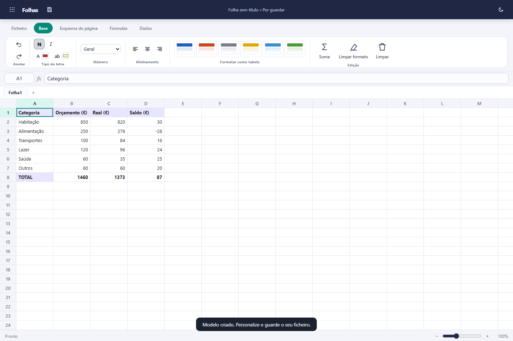

# MyOffice

**Suite de escritório para Windows: simples, privada e leve.**

Texto, folhas de cálculo, apresentações e diagramas numa só aplicação. Os documentos ficam no seu computador: não é precisa conta, nuvem nem ligação à Internet. Abre e grava ficheiros do Word, Excel e PowerPoint.

**[⬇ Descarregar MyOffice 1.7.0 para Windows (64 bits)](https://github.com/cadorio/myoffice/releases/download/v1.7.0/MyOffice-Setup-1.7.0.exe)**

[Notas da versão](https://github.com/cadorio/myoffice/releases/tag/v1.7.0) · [Versões anteriores](https://github.com/cadorio/myoffice/releases) · [Reportar um problema](https://github.com/cadorio/myoffice/issues)


## Índice

- [Um visual próprio](#um-visual-próprio)
- [As aplicações](#as-aplicações)
- [Instalação](#instalação)
- [Ficheiros do Microsoft Office](#ficheiros-do-microsoft-office)
- [Assistente](#assistente)
- [Fórmulas](#fórmulas)
- [Privacidade e segurança](#privacidade-e-segurança)
- [O que ainda não faz](#o-que-ainda-não-faz)
- [Desenvolvimento](#desenvolvimento)

## Um visual próprio

O MyOffice não imita o Office. Em vez da faixa de separadores no topo, cada aplicação tem um **estúdio**:

- **O documento ao centro**, com espaço para trabalhar e sem barras a ocupar o ecrã.
- **Painel de ferramentas à direita**, organizado em secções (Tipo de letra, Bordas, Alinhar…). Esconde-se com **Ctrl+.** quando precisa de mais espaço.
- **Barra de aplicações à esquerda**, sempre visível: passe de Texto para Folhas ou Diapositivos com um clique.
- **Procura de comandos (Ctrl+K)**: escreva o que quer fazer, como "borda", "gráfico" ou "PDF", e carregue em Enter. Não precisa de saber onde está cada botão.


Tons calmos de verde e papel, com modo claro e escuro.

## As aplicações

| Aplicação | Para quê | Formatos |
| --- | --- | --- |
| **Texto** | Cartas, relatórios e atas, com estilos, listas, tabelas, imagens, cabeçalhos, rodapés e números de página | `.modoc` · DOCX · PDF · HTML · TXT |
| **Folhas** | Contas, orçamentos e análise de dados, com fórmulas, gráficos e várias folhas por livro | `.mosheet` · XLSX · CSV · PDF |
| **Diapositivos** | Apresentações com temas, esquemas, imagens, formas, transições e notas do orador | `.moslides` · PPTX · PDF |
| **Desenho** | Fluxogramas, mapas mentais e organogramas | `.modraw` · SVG · PDF |
| **Assistente** | Ajuda sobre a aplicação e análise de textos e tabelas, sem Internet | — |

O ecrã inicial tem seis **modelos prontos a usar** (relatório, ata de reunião, orçamento mensal, gestor de tarefas, apresentação de projeto e apresentação de aula) e a lista de ficheiros recentes, com pesquisa.

### Texto


- Estilos de título, tipos de letra, cores, listas, tabelas, ligações e imagens.
- Cabeçalhos e rodapés com número da página e total de páginas, também no PDF e no DOCX.
- Localizar e substituir, quebras de página e contagem de palavras com tempo de leitura.
- Revisão ortográfica em português, quando o Windows a disponibiliza.
- **Rever**: comentários, controlo de alterações (aceitar ou rejeitar), notas de rodapé e índice automático.
- **Configurar página**: tamanho (A4, Carta, A5), orientação e margens.

### Folhas



- Até 100 000 linhas × 256 colunas por folha e até 100 folhas por livro, com separadores que se podem renomear.
- Mais de 30 funções, em português e em inglês (ver [Fórmulas](#fórmulas)).
- **Gráficos** de colunas e de linhas: selecione as categorias e os valores, abra **Dados › Gráfico** e guarde-o no livro. Os gráficos acompanham o ficheiro (também em XLSX) e podem ser exportados em SVG. Abrem na janela de gráficos; não ficam desenhados por cima das células.
- **Resumo dinâmico**: agrupa categorias e calcula soma, contagem e média com fórmulas que se atualizam com os dados. É uma alternativa às tabelas dinâmicas do Excel, não uma tabela dinâmica compatível.
- Bordas, unir e centrar células, fixar linhas e colunas, larguras de coluna (arrastar ou duplo clique para ajustar).
- **Preenchimento automático**: arraste o canto da célula para continuar números, meses, dias da semana e fórmulas.
- **Formatação condicional**: maior/menor que, entre, igual, contém texto e escala de cores.
- Estatística (mediana, moda, desvio padrão, variância), formatos de número e moeda, ordenação e filtros rápidos (os filtros não ficam guardados no ficheiro).

### Diapositivos


- 13 temas, cada um com quatro variantes de cor (Claro, Suave, Vivo, Escuro), e cinco esquemas de diapositivo.
- **Ideias de design**: propostas de composição com o conteúdo atual, que se aplicam com um clique e se podem anular.
- Transições (desvanecer, deslizar, revelar) e efeitos simples de entrada por elemento, também em PPTX.
- Notas do orador, modo de apresentação em ecrã inteiro e **vista do apresentador** (diapositivo seguinte, notas e cronómetro; tecla P).
- **Tabelas**, organizador de diapositivos com arrastar e largar, e alinhar, distribuir e agrupar vários objetos (Shift+clique).
- Atalhos: Ctrl+D duplica um elemento, as setas movem-no e Shift+setas move-o em passos maiores.

### Desenho


Comece por um modelo de fluxo, mapa mental ou organograma e acrescente caixas, círculos, decisões e ligações. Cada elemento tem texto e cor editáveis. Exporta em SVG para usar noutros documentos.

### Em todas as aplicações

- **Painel de ferramentas** à direita, em secções, e barra de aplicações à esquerda. Ctrl+. esconde ou mostra o painel.
- **Ctrl+K** abre a procura de comandos: escreva o que quer fazer.
- Modo claro e escuro, que acompanha o Windows ou se escolhe na aplicação.
- Zoom de 50% a 200% em Texto e Folhas.
- **Recuperação automática**: se a aplicação fechar inesperadamente, oferece-se para recuperar o trabalho por guardar.
- Pré-visualizar impressão (Ctrl+Shift+P), imprimir (Ctrl+P) e exportar para PDF (Ctrl+Shift+E).


## Instalação

| | |
| --- | --- |
| **Sistema** | Windows 10 (versão 22H2) ou Windows 11, 64 bits |
| **Memória** | 4 GB no mínimo, 8 GB recomendados |
| **Internet** | não é necessária para usar a aplicação |

1. [Descarregue o instalador](https://github.com/cadorio/myoffice/releases/download/v1.7.0/MyOffice-Setup-1.7.0.exe) (`MyOffice-Setup-1.7.0.exe`, 122 MB).
2. Abra o ficheiro e siga o assistente de instalação.
3. **Aviso do Windows:** o instalador ainda não tem assinatura digital, por isso o SmartScreen mostra "O Windows protegeu o computador". Clique em **Mais informações** e depois em **Executar mesmo assim**.

O instalador cria atalhos no menu Iniciar para abrir diretamente o Texto, as Folhas ou os Diapositivos. Os ficheiros `.modoc`, `.mosheet`, `.moslides` e `.modraw` passam a abrir com o MyOffice.

> Os requisitos de memória são objetivos e ainda não foram confirmados em computadores de diferentes idades.

## Ficheiros do Microsoft Office

O MyOffice abre e exporta `.docx`, `.xlsx` e `.pptx`. Ao abrir um destes ficheiros, avisa sobre o que pode não ser convertido e guarda a conversão num ficheiro próprio; **o original nunca é alterado**.

A conversão cobre o conteúdo e a formatação mais comuns, mas **não substitui o Microsoft Office** em documentos complexos:

| Formato | É convertido | Perde-se |
| --- | --- | --- |
| **DOCX** | Títulos, parágrafos e alinhamento, formatação de caracteres, listas, tabelas com células unidas, ligações, imagens, quebras de página, cabeçalho, rodapé, campos de página, **comentários, notas de rodapé, alterações controladas e configuração da página** (nos dois sentidos) | Colunas, caixas de texto, formas; cabeçalhos e rodapés complexos; a formatação dos comentários e das notas (fica só o texto) |
| **XLSX** | Até 100 folhas: valores, fórmulas (incluindo **referências a outras folhas**, como `Dados!A1`), estilos básicos, alinhamento, formatos de número e moeda, gráficos simples de colunas e linhas, bordas, células unidas, larguras de coluna, painéis fixos e **formatação condicional** (maior/menor que, entre, igual, contém texto, escala de cores) | Tabelas dinâmicas, gráficos avançados, alguns estilos, regras condicionais com fórmulas; funções não suportadas mostram `#NOME?` |
| **PPTX** | Texto e posição das caixas, listas, imagens, retângulos e elipses, **tabelas**, **cores do tema** do PowerPoint, fundo de cor ou **imagem**, notas do orador, transições e efeitos de entrada simples | Animações complexas, gráficos, SmartArt, células unidas e formatação dentro das tabelas |

As imagens WebP são convertidas para PNG, para poderem seguir em DOCX e PPTX. Os ficheiros exportados foram verificados com o LibreOffice e com as bibliotecas python-docx, openpyxl e python-pptx; **ainda não foram testados no Microsoft Office**.

## Assistente


O Assistente funciona inteiramente no computador, sem Internet, contas nem descarregamentos. Os documentos não saem da máquina.

- **Guias passo a passo** — pergunte "como unir células?", "como imprimo?" ou "como ativo o controlo de alterações?" e recebe os passos, com os nomes dos botões. Se a pergunta não tiver guia, procura na documentação e indica a secção.
- **Fórmulas a partir de uma frase** — "soma de B2 a B10" dá `=SOMA(B2:B10)`; "quantos valores maiores que 100 na coluna C" dá `=CONTAR.SE(C2:C100;">100")`. Também média, máximo, mínimo, PROCV, SE, percentagens e arredondamentos.
- **Rascunhos** — "escreve uma reclamação sobre a fatura da luz", "preciso de um pedido de férias", "faz um convite para o jantar de Natal": cartas, emails, reclamações, pedidos, atas, convites, agradecimentos e relatórios, com o assunto já preenchido. O botão **Inserir no Texto** coloca o rascunho no documento.
- **Trabalha com o que tem aberto** — "resume o meu documento" e "analisa a minha folha" usam o conteúdo real do Texto e das Folhas. As fórmulas têm o botão **Inserir na célula ativa**.
- **Perguntas de seguimento** — depois de "soma de B2 a B10", basta "e a média?".
- **Texto** — resume o documento, assinala frases longas e termos repetidos e propõe versões mais diretas das frases ("É importante referir que a empresa cresceu" → "A empresa cresceu").
- **Folhas** — para cada coluna numérica: total, média, máximo e mínimo com a linha correspondente, tendência do primeiro ao último valor e peso do maior valor no total.
- **Diapositivos** — propõe uma estrutura de apresentação a partir do tema e sugere versões mais concisas dos diapositivos.

**O que convém saber:** o Assistente não é um modelo de linguagem generativo como o ChatGPT. Usa pesquisa e regras próprias (um índice BM25 construído a partir desta documentação), por isso não escreve texto livre sobre qualquer assunto nem responde a perguntas fora do MyOffice. Em troca, é rápido, previsível e não inventa factos.

## Fórmulas

As fórmulas começam por `=`. Os argumentos separam-se com `;` ou `,`; dentro das fórmulas, o separador decimal é o ponto (`=A1*1.5`). Use `$` para fixar referências ao copiar (`$A$1`).

| Função | Em inglês | Exemplo |
| --- | --- | --- |
| `SOMA`, `MÉDIA` | `SUM`, `AVERAGE` | `=SOMA(A1:A10)` |
| `MÍNIMO`, `MÁXIMO` | `MIN`, `MAX` | `=MÁXIMO(A1:C1)` |
| `CONTAR`, `CONTAR.VAL`, `CONTAR.VAZIO` | `COUNT`, `COUNTA`, `COUNTBLANK` | `=CONTAR(A1:A10)` |
| `SE`, `SE.ERRO` | `IF`, `IFERROR` | `=SE(A1>10;"alto";"baixo")` |
| `E`, `OU`, `NÃO` | `AND`, `OR`, `NOT` | `=E(A1>0;B1>0)` |
| `SOMA.SE`, `CONTAR.SE`, `MÉDIA.SE` | `SUMIF`, `COUNTIF`, `AVERAGEIF` | `=SOMA.SE(A1:A9;">10";B1:B9)` |
| `SOMA.SES`, `CONTAR.SES` | `SUMIFS`, `COUNTIFS` | `=SOMA.SES(C2:C20;A2:A20;"Norte";B2:B20;">=100")` |
| `SOMARPRODUTO` | `SUMPRODUCT` | `=SOMARPRODUTO(B2:B20;C2:C20)` |
| `PROCV` | `VLOOKUP` | `=PROCV("pera";A1:C9;3;FALSO)` |
| `ARRED`, `INT`, `ABS`, `RAIZQ`, `POTÊNCIA`, `RESTO`, `PRODUTO`, `PI` | `ROUND`, `INT`, `ABS`, `SQRT`, `POWER`, `MOD`, `PRODUCT`, `PI` | `=ARRED(A1/3;2)` |
| `CONCATENAR`, `NÚM.CARACT`, `MAIÚSCULAS`, `MINÚSCULAS`, `COMPACTAR` | `CONCAT`, `LEN`, `UPPER`, `LOWER`, `TRIM` | `=A1&" "&B1` |
| `HOJE` | `TODAY` | `=HOJE()` |

Também existem funções de estatística (mediana, moda, desvio padrão e variância). Operadores: `+ - * / ^ %`, `&` para juntar texto e `= <> < > <= >=` para comparar.

## Privacidade e segurança

- **Sem rede:** a aplicação bloqueia todos os pedidos de rede e não abre páginas externas. Nada é enviado para a Internet, nem pelo Assistente.
- **Interface isolada:** corre em sandbox, sem acesso direto ao sistema; só o processo principal toca no disco, e apenas em ficheiros escolhidos nos diálogos do Windows.
- **Ficheiros abertos são limpos:** scripts, ligações perigosas e estilos capazes de imitar a interface são removidos antes de o conteúdo ser mostrado.
- **Gravação segura:** os ficheiros são gravados primeiro numa cópia temporária, por isso uma falha a meio não corrompe o documento.
- **CSV seguro:** o texto que outras folhas de cálculo executariam como fórmula é neutralizado na exportação.

**Ainda por fazer:** o instalador não tem assinatura digital (ver [instruções de assinatura](docs/assinatura-windows.md)) e a verificação de integridade do pacote não está ativa.

## O que ainda não faz

- Tabelas dinâmicas compatíveis com o Excel (o resumo dinâmico é a alternativa).
- Animações complexas.
- Coautoria em tempo real e armazenamento na nuvem.
- Correio eletrónico e calendário.
- Versões para macOS e Linux distribuídas oficialmente (o código suporta-as, mas só o instalador Windows é publicado).

## Desenvolvimento

Requer Node.js 22 ou superior.

```bash
git clone https://github.com/cadorio/myoffice.git
cd myoffice
npm install
npm start          # abre a aplicação
npm test           # testes do motor de fórmulas, do assistente e das licenças
npm run test:ui    # testes da interface no browser (requer o Playwright)
npm run dist:win   # cria o instalador Windows na pasta dist/
npm run train:ai   # reconstrói o índice do Assistente depois de alterar este README
```

O workflow **Instalador Windows** do GitHub Actions corre os testes e cria o instalador em cada alteração ao `main`. Uma tag `vX.Y.Z` (com `v` minúsculo) publica também uma release com o instalador anexado.

### Estrutura

```text
main.js            Processo principal: janela, menus, ficheiros, recuperação
preload.js         Ponte controlada entre a interface e o processo principal
ai.js              Assistente: pesquisa na documentação e análises
license.js         Chaves de licença e período experimental
src/
  index.html       Interface
  ai-model.json    Índice do Assistente (gerado por npm run train:ai)
  js/writer.js     Texto
  js/sheets.js     Folhas
  js/slides.js     Diapositivos
  js/draw.js       Desenho
  js/formula.js    Motor de fórmulas
  js/ooxml.js      Conversão DOCX, XLSX e PPTX
  js/themes.js     Temas partilhados
  js/assistant.js  Análise de texto, tabelas e diapositivos
build/             Ícones e configuração do instalador
docs/              Capturas de ecrã e instruções de assinatura
test/              Testes automáticos
tools/             Ferramentas de licenças, avisos de terceiros, capturas e índice do Assistente
```

## Licença

O MyOffice é software livre, distribuído sob a **[Licença Apache 2.0](LICENSE)**. Pode usar, modificar e distribuir o código, incluindo para fins comerciais, desde que mantenha o aviso de licença e o ficheiro [NOTICE](NOTICE) e indique as alterações que fez. A licença inclui uma concessão de patentes e não dá direito a usar o nome ou a marca MyOffice. As licenças dos componentes de terceiros estão em [THIRD-PARTY-NOTICES.md](THIRD-PARTY-NOTICES.md).

---

O MyOffice é um projeto independente, sem ligação à Microsoft. Microsoft Word, Excel e PowerPoint são marcas dos respetivos proprietários.
